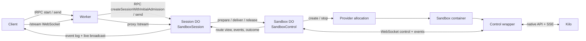
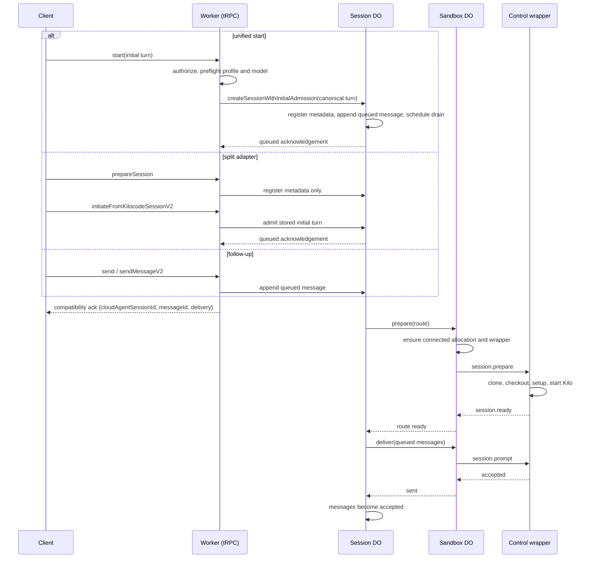
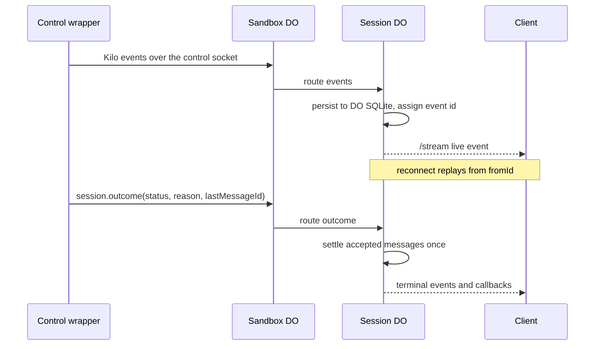
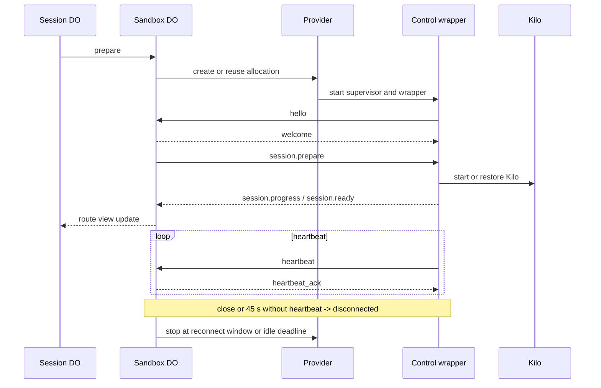
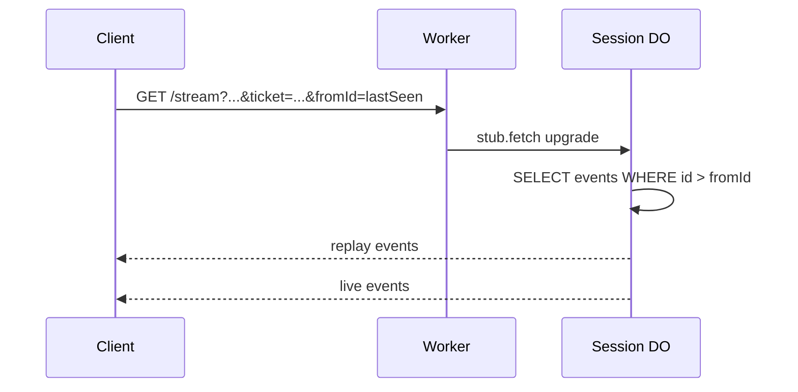
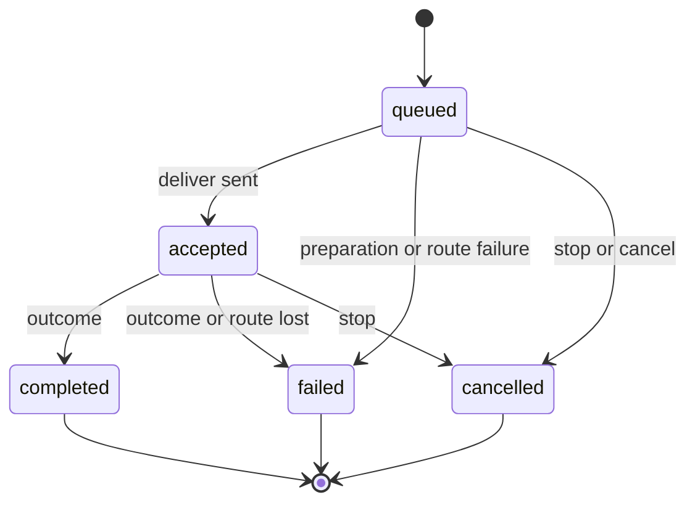

# Cloud Agent control-plane diagrams

These diagrams cover the current `workspace_*` control plane: queue-first message
acceptance, the Session and Sandbox DOs, wrapper delivery, streaming and
reconnect.

Implementation: `src/control-plane/session/`, `src/control-plane/sandbox/`, and
`wrapper/src/control-plane/`. The Worker exports `SandboxSessionV2` as
`SandboxSession` and `SandboxControlV2` as `SandboxControl`.

---

## 1) System overview

---

## 2) Message admission and delivery

---

## 3) Event and outcome flow

---

## 4) Sandbox and wrapper lifecycle

---

## 5) Client reconnect and replay

---

## 6) Message state machine

