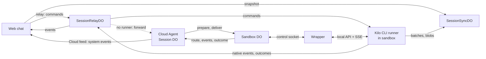

# Hosted remote chat (proposed)

## Status and scope

**Proposed. Not implemented.** This document records the agreed direction and the open
decisions. It does not change `docs/control-plane.md` until a phase lands.

- Kilo v2 and session-sync only. Kilo v1 and the session-ingest remote path are out of scope.
- First client: the Cloud Agent web chat. The IDE facade, mobile and the extension keep
  `/stream` for now and move later.
- Session-sync access stays creator-only (current ACL).

## Goal

A Cloud Agent sandbox is infrastructure that runs Kilo. The user talks to that Kilo through
the session-sync remote connection, the same way as to a locally running CLI. The only
difference for a hosted session is the sandbox: it has infrastructure events and it can be
asleep.

| Traffic | Path |
|---|---|
| Chat: native events, prompts, answers, interrupt, commands | Session-sync relay, between the web client and the Kilo CLI runner in the sandbox |
| Infrastructure: preparation, Cloud status, sandbox status, failures, message delivery states | Wrapper → Sandbox DO → Session DO → Cloud feed |
| Commands while no runner is connected | Session-sync forwards them to Cloud Agent, which uses its existing queue, preparation and failure behavior |

The wrapper keeps its local Kilo event feed and keeps forwarding events to the Session DO.
Cloud keeps supervision, turn outcomes, reports, callbacks, billing and sidebar status.

## Decisions

1. Uplink option C: interactive clients send every chat command through session-sync.
   Cloud Agent supplies compute, wake-up and the offline path.
2. Session-sync becomes the transcript authority for hosted sessions in a later phase.
   This adopts `services/session-sync/docs/native-history-consolidation.md`.
3. Auto-commit and condense become session (workspace) settings, not per-message intent.
   They apply to every completed native turn, whatever path started it.
4. The remote connection is a proxy. Commands and replies keep their native structure.
   The CLI command surface grows to cover what Cloud Agent needs.
5. Cloud Agent observes every native session in its runtimes. It adopts what it observes
   (prompts from the relay, sessions from `/new`) instead of requiring Cloud admission.

## Target flow

### Routing rule

One rule, owned by session-sync:

- Runner connected: the relay delivers the command to the CLI runner.
- No runner, and the session is hosted: session-sync forwards the command to Cloud Agent.
  Cloud applies today's behavior for that command type.
- No runner, and the session is local: today's relay behavior (mailbox or `runner_offline`).

| Command | Runner connected | Hosted, no runner (forwarded to Cloud) |
|---|---|---|
| `send_message` | Runner executor | Queued Cloud message with the same message ID. Cloud prepares the sandbox and delivers it. Preparation failure fails it with a specific reason. |
| `interrupt` | Runner executor (live run) | Cloud Stop: cancel queued work; during preparation, workspace Stop |
| `question_reply`, `question_reject`, `permission_respond` | Runner executor (live run) | Today's rule: the answer becomes a new message (`control-plane/session/answers.ts`) |
| `drop_queued_message` | Runner executor | Cancel that queued Cloud message |
| `send_command` | Runner executor | Queued Cloud command message |

A runner disconnect with unacknowledged non-live commands also forwards them to Cloud. Kilo
stores messages by ID, so a replay into a surviving Kilo database is idempotent.

The first message of a new session still uses Cloud `start`: the native session does not
exist in session-sync before the CLI uploads it.

## Component changes

### Kilo CLI (`Kilo-Org/kilocode`, outside this repository)

- Run the remote host in hosted mode: `KILO_REMOTE=1`, `KILO_REMOTE_KIND=remote`, set by the
  wrapper in `kilo2RuntimeEnvironment` (`wrapper/src/control-plane/runtime-harness.ts`).
- Get runner tickets through the hosted credential (see Session-sync).
- `send_message`: accept a client message ID, attachments, agent, model and variant. Today
  it accepts text only and derives the message ID from a hash of the command ID.
- `send_command`: run the session's full command catalog, including profile commands. Today
  only `/compact`, `/new`, `/skill`, `/models` and `/agents` run.
- Commands that the wrapper delivers from the Cloud queue use the same executor, through a
  local RPC. One executor, two transports.
- Flush the sync journal before a turn reports completion (phase 3).

### Session-sync

- **Hosted runner tickets.** The runtime handle is upload-only today (401 on live routes,
  403 `upload_only` elsewhere). Add a binding method to `SessionSyncAuthorization`
  (`src/session-sync-authorization.ts`) that authorizes `runner` tickets for the handle's
  root and stored descendant sessions only, valid only while the allocation is current.
  Viewer and controller tickets stay human-only.
- **Hosting binding.** Record the hosting Cloud Agent session on registration from the hosted
  principal, so the relay knows where to forward.
- **Forwarding.** When a hosted session has no runner, forward commands to Cloud Agent
  through a service binding and record the hand-off. Cloud results return through the
  Cloud feed and native events.
- **Direct watch signal (proposed).** The relay tells its runner on the session socket when
  viewers attach and leave. Hosted runners then need no presence socket, so they do not
  use the 32-instance and 128-watch presence budgets.
- **Phase 3:** hosted restore reads, Cloud-initiated deletion tombstone, hosted retention.

### Wrapper

- Open a Cloud turn when it observes a native user message on a route root that Cloud did
  not deliver. Today the wrapper creates turns only from `session.prompt`
  (`turn.ts`, `observeFeed`: no turn means no outcome, completion runner or finalization).
- Read auto-commit and condense from the route's session settings.
- Deliver queued Cloud messages through the CLI command executor.

### Session DO and Sandbox DO

- Keep receiving and storing native events. All current consumers keep working.
- Adopt an observed native user message as an `accepted` message with its native ID, then
  settle it from the wrapper outcome. Reports, callbacks and sidebar status then cover
  relay prompts.
- Accept forwarded commands from session-sync and map them onto existing operations.
- Adopt a root native session observed in a route's runtime (`/new`) as a sibling chat in
  the same workspace. Today its events are dropped, or attached to the one active turn on
  that runtime (`turn.ts`, `emittingRoute`). No Session DO or sidebar row is created.
- Store auto-commit and condense as session settings.
- Phase 3: stop storing the transcript; keep the projections (pending interactions, status,
  cost, lineage, callback text) and restore new sandboxes from session-sync.

### Web client

- Hosted chat transcript: `NativeSyncClient` snapshot plus relay events, rendered through
  the shared `readKilo2Messages` projection.
- Cloud feed for system events. `/kilo/cloud-agent/event` (`src/kilo-facade/system-feed.ts`)
  already carries `preparing`, `cloud.status` and `cloud.sandbox.status`. Extend it with
  `cloud.message.*`, auto-commit and worktree events, or use `/stream` with a type filter.
- Production auth: the web server performs the session-sync exchange and returns only the
  five-minute sync grant. The browser never holds a `kilo-api` credential. Today
  `/api/native-remote/token` is development-only.
- Allow the session-sync origin in the production CSP.

## Phases

| Phase | Content | Exit |
|---|---|---|
| 0. Spikes | WebSocket from the sandbox to session-sync through Containers outbound interception and the Vercel network policy (no test exists). Hosted runner ticket prototype. CLI remote host inside `kilo2 serve`. | Each spike works locally, or we have an alternative |
| 1. Read path | Hosted runner, production browser auth, web transcript from the relay behind a flag. Sends stay on Cloud. | Transcript parity with `/stream` on the local e2e matrix |
| 2. Write path | Routing rule and forwarding, CLI command gaps, turns from native observation, message adoption, session-level finalization, `/new` adoption | Acceptance scenarios in `control-plane.md` pass with relay sends |
| 3. History authority | Session-sync as hosted transcript authority, restore, deletion, retention, flush before completion | Consolidation doc release gates |
| 4. Capacity | Direct watch, caps, runner rate, relay runner liveness | Measured load profile |

## Open decisions

1. **Wake path.** Recommended: session-sync forwards the command to Cloud (above). This
   reuses Cloud's queue, preparation, Stop epoch and failure reasons. Alternative: the relay
   keeps the command in its mailbox and only asks Cloud to wake the sandbox. That gives one
   delivery path into Kilo, but needs new states for wake failure and mailbox rejection.
2. **Answers after the sandbox stopped.** Recommended: keep today's rule (new message),
   applied by Cloud on the forwarded command. The native question ends with its
   execution, so a new runtime has no pending form to answer.
3. **Presence for hosted runners.** Direct watch signal or presence with larger caps.
4. **Per-send checks on the live path.** Relay sends skip the Worker send preflight. The
   gateway still enforces credits per model call and session-sync checks membership at
   exchange. Confirm that profile model pins are enforced by the runtime configuration.

## Risks

- Relay runner liveness is socket-only, with no heartbeat. The Sandbox DO heartbeat stays
  the sandbox liveness authority; the relay state decides only routing.
- The CLI drops event frames over 64 KiB, and the relay drops an event whose wrapped frame
  is over 64 KiB. Large tool output reaches the viewer only through snapshot recovery.
- Runner rate is 6,000 events per minute per session.
- Abrupt sandbox loss drops the part of the transcript that was not uploaded (phase 3).
